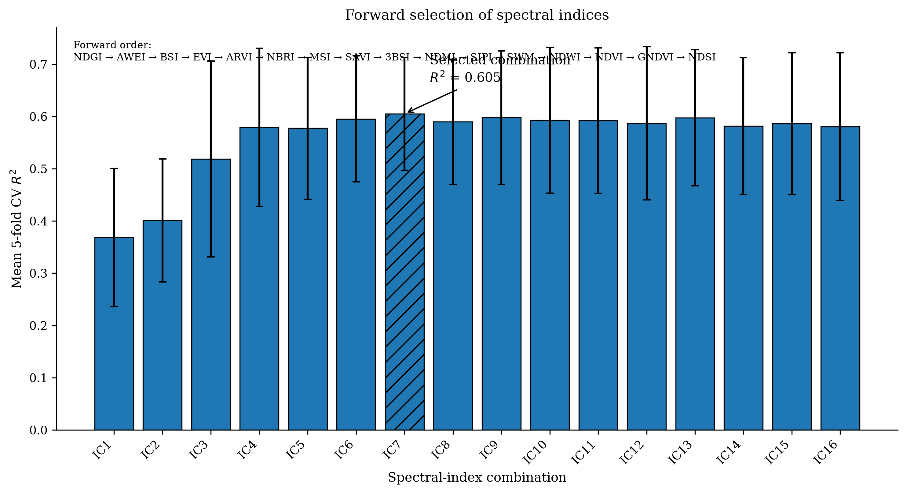
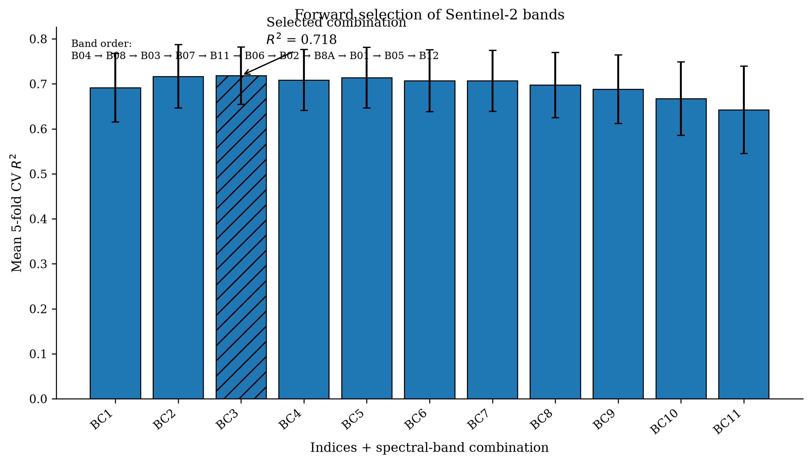
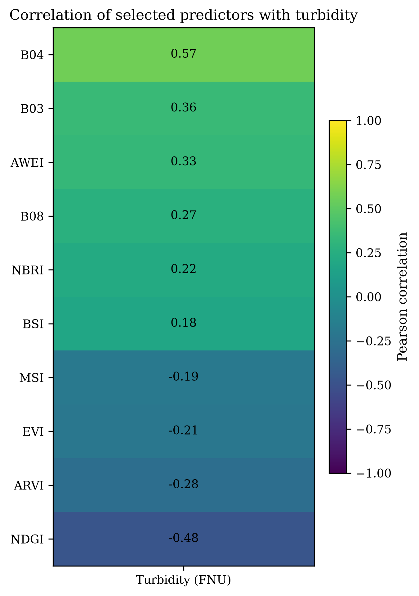
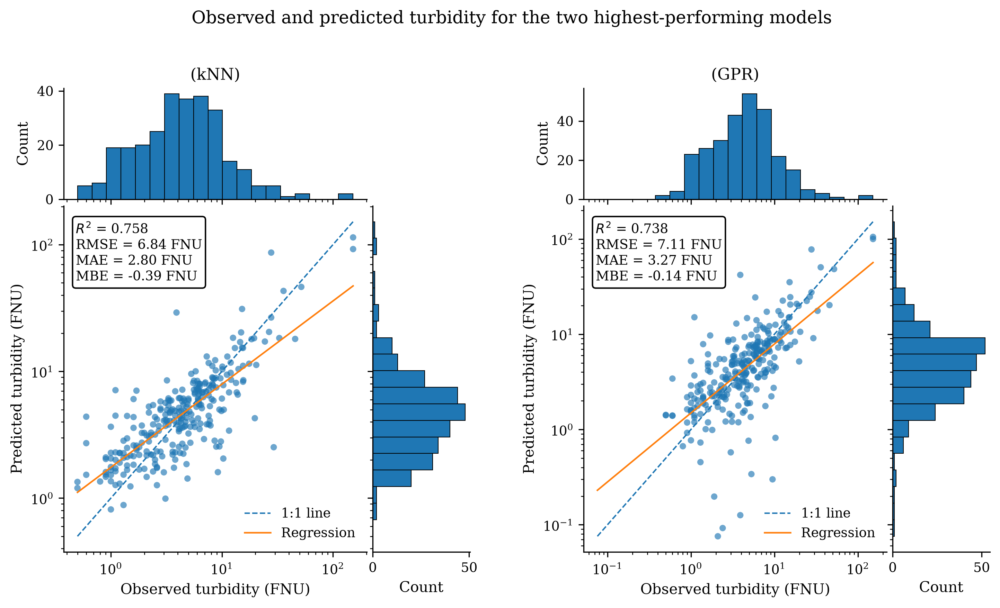

# Sentinel-2 Turbidity Modeling in the Delaware River Basin Using Machine Learning and Gaussian Process Regression

## 1. Project Overview

Turbidity is an important indicator of river water quality, while fixed monitoring stations provide limited spatial coverage. Satellite remote sensing can complement conventional monitoring by providing repeated spectral observations across large river networks [1].

This project investigates whether **Sentinel-2 aquatic reflectance** can be used to estimate turbidity across multiple monitoring stations in the **Delaware River Basin**. The study transfers the machine-learning framework developed by **Santos et al. (2025) [1]** to a different river system and extends it by evaluating **Gaussian Process Regression (GPR)** alongside conventional machine-learning models.

A key methodological difference is the satellite product used. Santos et al. [1] used Sentinel-2 Level-1C top-of-atmosphere reflectance, whereas this study uses **USGS ACOLITE Dark Spectrum Fitting (DSF) aquatic reflectance** [2,3]. ACOLITE DSF was developed specifically for atmospheric correction in aquatic remote-sensing applications [4].

---

## 2. Research Question

**Can Sentinel-2 ACOLITE aquatic reflectance and spectral indices accurately estimate river turbidity across the Delaware River Basin, and can Gaussian Process Regression improve upon conventional machine-learning approaches?**

A secondary objective was to evaluate whether the modeling framework of Santos et al. [1] transfers successfully to a different river network and an atmospherically corrected aquatic-reflectance product.

---

## 3. Data

The project uses the USGS dataset:

**Aquatic reflectance data from Sentinel-2 satellite imagery paired with continuous water quality measurements across the Delaware, Illinois, Trinity, Upper Colorado, and Willamette River basins in the United States from July 2015 through September 2024** [2].

Only observations from the **Delaware River Basin** were retained.

### Final Dataset

| Characteristic | Value |
|---|---:|
| Monitoring stations | 7 |
| Final observations | 1,402 |
| Training observations | 1,121 |
| Held-out test observations | 281 |
| Train/test split | 80/20 |
| Median turbidity | ~4.1 FNU |
| Maximum turbidity | 187 FNU |

The Sentinel-2 product contains aquatic reflectance for bands **B01-B08, B8A, B11, and B12** [2,3]. Reflectance was produced using **ACOLITE DSF atmospheric correction** [3,4] and paired with continuous USGS water-quality observations [2].

Quality control included:

- Delaware Basin and turbidity filtering
- temporal matching of water-quality and Sentinel-2 observations
- ACOLITE quality-flag filtering
- removal of invalid spectral values
- turbidity quality control
- removal of observations with incomplete predictor data

The final modeling dataset contained one model-ready observation per valid station-scene matchup.

---

## 4. Methodology

The final experiment was designed as a **literature-guided transfer of the Santos et al. (2025) methodology [1]**, adapted to the available USGS ACOLITE dataset.

### Spectral Feature Construction

Santos et al. [1] investigated combinations of Sentinel-2 spectral indices and individual bands using forward stepwise feature selection. Following the same general strategy, sixteen available spectral indices were calculated in this study.

GCI from the original framework could not be reproduced because Sentinel-2 Band 09 is not available in the USGS matched reflectance dataset [2].

Forward stepwise feature selection was performed using **XGBoost and five-fold cross-validated R²**, following the feature-selection logic used by Santos et al. [1].

Seven spectral indices were retained:

**NDGI, AWEI, BSI, EVI, ARVI, NBRI, and MSI**



*Figure 1. Forward stepwise selection of spectral-index combinations using five-fold cross-validated R². Error bars represent standard error across folds.*

After fixing the selected spectral-index set, individual Sentinel-2 reflectance bands were evaluated using the same forward-selection procedure.

Three bands were retained:

**B04, B08, and B03**



*Figure 2. Forward selection of Sentinel-2 spectral bands after fixing the selected spectral-index set.*

The resulting model contained **10 original predictors**. Following Santos et al. [1], cube-root versions of the selected predictors were also included to reduce skewness, producing **20 final model inputs**.



*Figure 3. Pearson correlation between the selected original predictors and observed turbidity.*

### Model Development

Five conventional regression models were evaluated:

- Random Forest
- XGBoost
- Support Vector Regression
- k-Nearest Neighbors
- LASSO

These model families were selected to remain comparable with the machine-learning framework evaluated by Santos et al. [1].

Preprocessing and hyperparameters were selected using **five-fold cross-validation on the training data only**.

The preprocessing strategies evaluated, where appropriate, were:

- no transformation
- standard scaling
- Yeo-Johnson transformation
- Yeo-Johnson followed by standard scaling

### Gaussian Process Regression Extension

**Gaussian Process Regression** was introduced as the main methodological extension.

Three covariance kernels were evaluated:

- Radial Basis Function
- Matérn 3/2
- Rational Quadratic

The **Rational Quadratic kernel** produced the strongest GPR cross-validation performance and was selected for final testing.

### Validation Strategy

The dataset was divided into an **80/20 training-test split**, consistent with the general validation framework used by Santos et al. [1].

The **281-observation test set remained untouched during model development**.

Feature selection, preprocessing selection, model tuning, and GPR kernel selection were conducted using the training data only. The held-out test set was evaluated after all modeling decisions had been frozen.

Final performance was assessed using:

- coefficient of determination (R²)
- root mean squared error (RMSE)
- normalized RMSE (nRMSE)
- mean absolute error (MAE)
- mean bias error (MBE)

---

## 5. Key Results

### Final Held-Out Performance

| Model | Test R² | RMSE (FNU) | MAE (FNU) | MBE (FNU) |
|---|---:|---:|---:|---:|
| **kNN** | **0.758** | **6.840** | 2.800 | -0.392 |
| **GPR** | **0.738** | 7.110 | 3.268 | -0.139 |
| XGBoost | 0.735 | 7.157 | 2.839 | -0.054 |
| Random Forest | 0.733 | 7.178 | 2.763 | -0.049 |
| SVR | 0.716 | 7.411 | **2.720** | -0.895 |
| LASSO | 0.608 | 8.701 | 3.521 | -0.074 |



*Figure 4. Observed and predicted turbidity for kNN and GPR on the independent held-out test set. Marginal distributions show the observed and predicted turbidity distributions.*

### Main Findings

1. **kNN achieved the strongest overall held-out performance.**  
   It achieved **R² = 0.758** and **RMSE = 6.84 FNU**, explaining approximately 75.8% of the variance in unseen test observations.

2. **GPR was competitive but did not outperform kNN.**  
   GPR achieved **R² = 0.738** and ranked second by held-out R², slightly outperforming XGBoost, Random Forest, SVR, and LASSO according to this metric.

3. **The strongest model differed from the original study.**  
   Santos et al. [1] reported pooled XGBoost as their strongest overall model, with an R² of approximately 0.757, whereas kNN produced the strongest held-out performance in the Delaware experiment.

4. **Useful predictors were not restricted to water-specific indices.**  
   This is consistent with Santos et al. [1], who showed that indices originally developed for vegetation, moisture, soil, snow, and related applications may still contain useful spectral information for turbidity modeling.

5. **No single model dominated every error metric.**  
   kNN achieved the strongest R² and RMSE, SVR produced the lowest MAE, and Random Forest had the smallest absolute MBE among the conventional models.

---

## 6. Interpretation

The strong performance of kNN suggests that the Delaware observations contain useful **local structure in spectral feature space**.

kNN predicts an unknown observation from nearby observations in multidimensional feature space rather than fitting one global functional relationship. Santos et al. [1] also found that kNN could outperform more complex models at an individual monitoring station and related this behavior to the model's ability to identify similar observations.

Standardization was particularly important for kNN because the algorithm relies directly on distances among predictor values.

The use of **ACOLITE DSF aquatic reflectance** may also improve the comparability of aquatic spectral measurements by reducing atmospheric contributions [3,4]. However, this study did **not** perform a direct comparison between Level-1C top-of-atmosphere reflectance and ACOLITE-corrected reflectance. Therefore, the stronger kNN result cannot be attributed specifically to atmospheric correction.

GPR also produced competitive performance. The Rational Quadratic kernel provided the strongest GPR cross-validation result, but kNN remained the strongest model on the independent test set. The results therefore do not support the conclusion that GPR universally improves upon conventional machine-learning approaches.

Overall, the study demonstrates that publicly available Sentinel-2 aquatic reflectance [3] combined with USGS continuous water-quality observations [2] can support data-driven river turbidity estimation.

---

## 7. Limitations

The main limitations of the study are:

- The final evaluation uses a random 80/20 train-test split, following the transferred Santos methodology [1]. It evaluates unseen observations but does not represent complete spatial transfer to entirely unseen monitoring stations.
- The Delaware turbidity distribution is strongly skewed toward relatively low turbidity values, with comparatively few extreme events.
- Only seven monitoring stations were included, limiting geographic generalization.
- ACOLITE reflectance was not directly compared with Level-1C top-of-atmosphere reflectance.
- Sentinel-2 Band 09 was unavailable in the matched USGS dataset [2], preventing reproduction of GCI from the original Santos feature set [1].
- GMDH was not included in the final comparison because the published implementation did not provide sufficient detail for an exact reproducible transfer.

The reported results should therefore be interpreted as **held-out predictive performance within the studied Delaware dataset**, rather than evidence that the trained models will perform equally well in unrelated river systems.

---

## 8. Repository Structure

```text
delaware-turbidity-sentinel2-ml/
│
├── 01_data/
│   ├── raw/
│   └── processed/
│
├── 04_src/
│   ├── data_preparation/
│   ├── baseline_modeling/
│   └── literature_extension/
│       ├── 01_build_dataset.py
│       ├── 02_select_features.py
│       ├── 03_train_baselines.py
│       ├── 04_train_gpr.py
│       ├── 05_final_evaluation.py
│       └── 06_make_figures.py
│
├── 05_results/
│   ├── tables/
│   └── metrics/
│
├── figures/
│   ├── figure_1_index_selection.png
│   ├── figure_2_band_selection.png
│   ├── figure_3_feature_correlation.png
│   └── figure_4_observed_vs_predicted.png
│
├── README.md
├── requirements.txt
└── .gitignore
```

Large source datasets are not stored directly in this repository.

---

## 9. How to Reproduce

Install the required dependencies:

```bash
pip install -r requirements.txt
```

Run the literature-guided analysis from the repository root:

```bash
python 04_src/literature_extension/01_build_dataset.py
python 04_src/literature_extension/02_select_features.py
python 04_src/literature_extension/03_train_baselines.py
python 04_src/literature_extension/04_train_gpr.py
python 04_src/literature_extension/05_final_evaluation.py
python 04_src/literature_extension/06_make_figures.py
```

These scripts reproduce the model-ready dataset, feature-selection results, model configurations, held-out predictions, evaluation metrics, and final figures.

The original USGS datasets should be downloaded separately from the sources listed below.

---

## 10. Tools Used

- Python
- pandas
- NumPy
- scikit-learn
- XGBoost
- Gaussian Process Regression
- Matplotlib
- Sentinel-2 MSI
- ACOLITE DSF
- USGS continuous water-quality observations

---

## 11. References and Data Sources

**[1] Santos, V. O., Rocha, P. A. C., Thé, J. V. G., & Gharabaghi, B. (2025).**  
*Evaluation of machine learning methods for forecasting turbidity in river networks using Sentinel-2 remote sensing data.*  
**Ecological Informatics, 90**, 103313.  
https://doi.org/10.1016/j.ecoinf.2025.103313

**[2] Ball, G. P., & Ducar, S. D. (2025).**  
*Aquatic reflectance data from Sentinel-2 satellite imagery paired with continuous water quality measurements across the Delaware, Illinois, Trinity, Upper Colorado, and Willamette River basins in the United States from July 2015 through September 2024.*  
U.S. Geological Survey Data Release.  
https://doi.org/10.5066/P1A7T4FV

**[3] King, T. V., Meyer, M. F., Hundt, S. A., Ball, G. P., Hafen, K. C., Avouris, D. M., Ducar, S. D., Wakefield, B. F., Stengel, V. G., & Vanhellemont, Q.**  
*Sentinel-2 ACOLITE-DSF Aquatic Reflectance for the Conterminous United States.*  
U.S. Geological Survey Data Release.  
https://doi.org/10.5066/P904243C

**[4] Vanhellemont, Q. (2019).**  
*Adaptation of the dark spectrum fitting atmospheric correction for aquatic applications of the Landsat and Sentinel-2 archives.*  
**Remote Sensing of Environment, 225**, 175–192.  
https://doi.org/10.1016/j.rse.2019.03.010